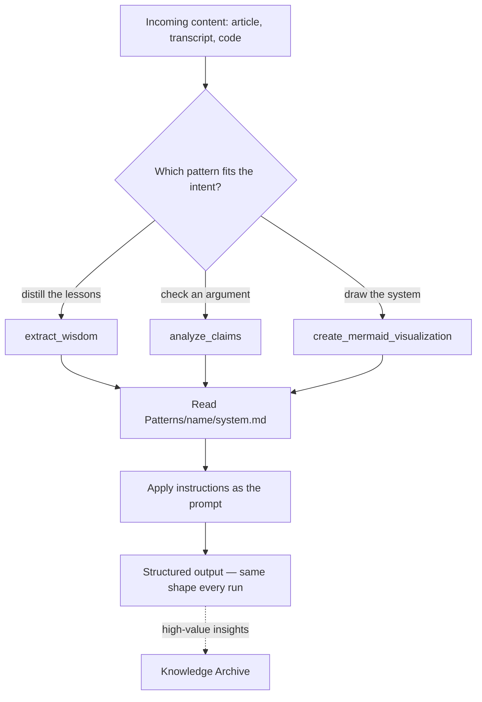

# Fabric Pattern System Reference

> Fabric patterns are reusable moves in the LifeOS hill-climb (`LifeOs/LifeOsThesis.md`) — packaged transformations the DA applies to incoming content.

**Primary Skill:** `~/.claude/skills/Fabric/SKILL.md`

This document provides a quick reference. For full functionality, invoke the Fabric skill.

---

## Quick Reference

**Patterns Location:** `~/.claude/skills/Fabric/Patterns/` (233 patterns at v8.24.0)

### Invoke Fabric Skill

| User Says | Action |
|-----------|--------|
| "use fabric to [X]" | Execute pattern matching intent |
| "run fabric pattern [name]" | Execute specific pattern |
| "update fabric patterns" | Sync patterns from upstream |
| "use fabric to extract wisdom from [content]" | Run extract_wisdom pattern (a bare "extract wisdom" with no mention of Fabric goes to the ExtractWisdom skill) |
| "summarize with fabric" | Run summarize pattern |

### Native Pattern Execution

LifeOS executes patterns natively (no CLI spawning):
1. Reads `Patterns/{pattern_name}/system.md`
2. Applies pattern instructions directly as prompt
3. Returns structured output
4. A summarize-family pattern (`summarize`, `create_5_sentence_summary`, `create_micro_summary`, `summarize_paper`, `summarize_lecture`, `summarize_meeting`, `summarize_debate`, `youtube_summary`) run on a URL or on text of 200 characters or more also fires the installed harvest skill on the same input, which writes a KNOWLEDGE note (Intents/ExecutePattern.md, Tool contract)
5. Extracted insights may be captured in the Knowledge Archive (`MEMORY/KNOWLEDGE/`) by the Algorithm LEARN phase or KnowledgeHarvester as a person, company, idea, blog, research or book note

**Example:**
```
User: "Use fabric to extract wisdom from this article"
-> Fabric skill invoked
-> ExecutePattern intent selected
-> Reads Patterns/extract_wisdom/system.md
-> Applies pattern to content
-> Returns IDEAS, INSIGHTS, QUOTES, etc.
```

### Finding a pattern: the catalog and the suggester (2026-11-14)

The pattern files carry no metadata and are overwritten on every sync, so the metadata lives beside them in a generated sidecar, `skills/Fabric/Patterns/catalog.yaml`: one entry per pattern (purpose, category, triggers, input, output, the ported intent that runs instead, and the sha256 of its `system.md`). `Tools/PatternCatalog.ts build` derives it from `pattern_explanations.md` and each pattern's IDENTITY and OUTPUT sections, with one cached model pass only for a pattern no explanation line covers; `check` fails when a pattern has no entry or its hash moved, and `CheckPatterns.ts` runs that check. The install's own local patterns get their own catalog under `USER/CUSTOMIZATIONS/SKILLS/Fabric/`, merged at read time and never written into the shipped file.

A request that names no pattern goes through `Tools/SuggestPattern.ts "<request>"`: trigger and keyword match first, then one shadow Assay question over the shortlist when the engine is reachable (caller `pattern-suggest`, fail-open), and the top three come back with a reason each. ExecutePattern shows the pick as `Pattern: <name> (<reason>)` before the pattern runs; a request that names a pattern or a ported intent skips the suggester and makes no model call. The sixteen-row keyword table this replaced is gone; the catalog is the one source, and `PatternCatalog.ts triggers` can regenerate the skill's USE WHEN list from it.

### When to Use Fabric CLI Directly

Only use `fabric` command for:
- **`-y URL`** - YouTube transcript extraction
- **`-u URL`** - fetch a public URL when the native fetch fails to retrieve it; it does not bypass a site's access controls, and a page that refuses automated access stays unread

Never use `fabric -U` to update: patterns are updated only through the UpdatePatterns intent, from a fresh upstream clone.

---

## Pattern Categories

| Category | Count | Key Patterns |
|----------|-------|--------------|
| **Extraction** | 30+ | extract_wisdom, extract_insights, extract_main_idea |
| **Summarization** | 20+ | summarize, create_5_sentence_summary |
| **Analysis** | 30+ | analyze_claims, analyze_logs, analyze_threat_report |
| **Creation** | 50+ | create_threat_model, create_prd, create_mermaid_visualization |
| **Improvement** | 10+ | improve_writing, improve_prompt, review_code |
| **Security** | 15 | create_stride_threat_model, create_sigma_rules |
| **Rating** | 8 | rate_content, judge_output |

---

## Updating Patterns

**Via Skill (Recommended):**
```
User: "Update fabric patterns"
-> Fabric skill > UpdatePatterns intent
-> Clones upstream fabric, copies data/patterns/ into ~/.claude/skills/Fabric/Patterns/
-> Keeps local-only patterns and reports them
```

The source is always a fresh upstream clone, never `fabric -U` or `~/.config/fabric/patterns/`, which mixes in local patterns (`skills/Fabric/Intents/UpdatePatterns.md`).

---

## Examples

### One pattern, one transformation

The whole idea at its smallest: **a developer just watched a 90-minute conference talk and has the transcript, but doesn't want to re-read it.** They run one pattern instead of writing a prompt from scratch.

- **Ask:** "use fabric to extract wisdom from this transcript."
- **What happens:** the skill reads `Patterns/extract_wisdom/system.md`, applies those instructions to the transcript, and returns structured output — IDEAS, INSIGHTS, QUOTES, RECOMMENDATIONS.
- **Why it matters:** the transformation is *packaged and repeatable*. The next transcript, and the one after that, run through the identical move and come back in the identical shape. The developer never re-invents "how do I pull lessons out of a talk" — that thinking is captured once, in the pattern.

That is the entire point of a pattern: a reusable move you apply to content, not a prompt you rewrite each time.

### The same input, different patterns

Because a pattern is just a packaged transformation, the same piece of content can go through several:

- Feed a written argument to `analyze_claims` and get each claim rated for evidence.
- Feed a system description to `create_mermaid_visualization` and get a diagram back.
- Feed a rough draft to `improve_writing` and get a cleaner version.

Same content, different move, different structured result — and each result comes out the same way every time you run it.

### When a pattern fits (and when it doesn't)

- **Good fit:** a transformation you want to run *the same way, repeatedly*, across different content — distilling talks, checking arguments, drafting threat models. The repetition is what a pattern is for.
- **Not a fit:** a one-off question with no reusable shape ("what's the third heading in this file?"). Wrapping that in a pattern is overhead — just answer it directly.

The test: if you'd want the *next* piece of content handled the same way, it's a pattern. If the move dies with this one input, it isn't.



The diagram shows why patterns compose: the *content* is the variable, the *pattern* is the fixed transformation, and the output shape is a property of the pattern, not the input. Swap the pattern and you get a different move over the same material; keep the pattern and every input comes back in one predictable form — which is what makes the results worth capturing into the Knowledge Archive.

---

## See Also

- **Full Skill:** `~/.claude/skills/Fabric/SKILL.md`
- **Pattern Execution:** `~/.claude/skills/Fabric/Intents/ExecutePattern.md`
- **Pattern Updates:** `~/.claude/skills/Fabric/Intents/UpdatePatterns.md`
- **All Patterns:** `~/.claude/skills/Fabric/Patterns/`
- **Architecture:** `~/.claude/LIFEOS/DOCUMENTATION/LifeosSystemArchitecture.md` — Master LifeOS architecture reference
