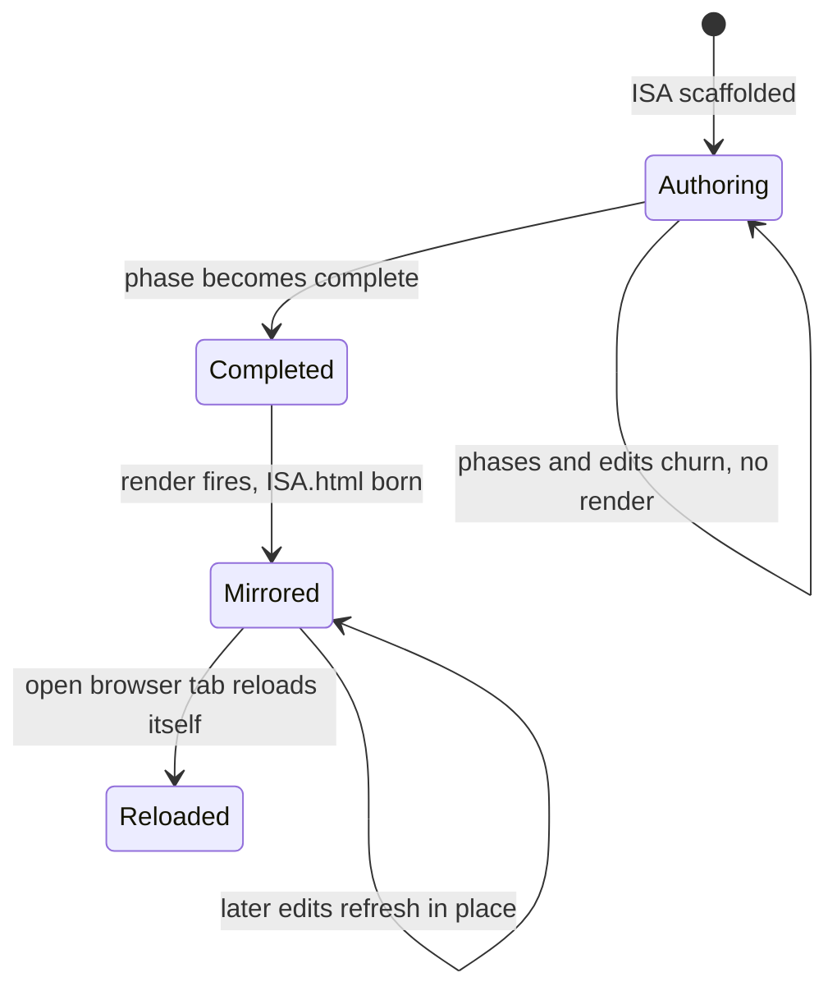

# ISA HTML Mirror

The ISA is the canonical articulation of "done" for any Algorithm run. It lives as `ISA.md` markdown in a working directory the principal does not normally look at. The **HTML Mirror** is a deterministic, zero-token, branded sibling — `ISA.html` next to every `ISA.md` — produced by a fast CLI on completion events and refreshed in-place by Interceptor.

## Canonical Theme — LifeOS Technical v1.0.0 (2026-05-13)

**The LifeOS Technical theme is the official HTML format for every ISA in the system going forward.** Tokyo-Night-Storm-derived dark navy ground (`--lifeos-bg-base: #0d1325`), JetBrains Mono throughout, lavender-white type, calm cyan/violet accents, status-pill ISC rows that read "OPEN / DONE / WIP / ANTI / ANTE" at a glance. Lives at `~/.claude/LIFEOS/TOOLS/ISARender/template.css`. The same stylesheet is inlined by `LIFEOS/TOOLS/DocRender.ts` for any non-ISA document (an analysis or report) so prose pages and ISA pages share one theme source (`LIFEOS/DOCUMENTATION/Tools/Tools.md` § DocRender.ts).

**Lineage.** The theme was specified by the Pulse-side parent design (token palette, naming convention, dimension preservation rules) and applied to the ISA mirror surface, plus a status-clarity refinement.

**Replaces.** The prior `LifeOS Engineering Register v2.1.0` (sepia/parchment, EB Garamond) shipped 2026-05-12 and was deprecated 2026-05-13. Every existing `LIFEOS/MEMORY/WORK/*/ISA.html` has been backfilled to the new theme; no LifeOS Engineering Register renders remain on disk.

**Status visual contract.** Every ISC row leads with a status pill:

| Status × Kind | Pill | Color | Meaning |
|---|---|---|---|
| pending normal | `○ OPEN` | muted gray on dark | Default — work not yet done |
| passed normal | `✓ DONE` | solid green, navy text, glow | Verified complete |
| deferred normal | `◐ WIP` | amber on amber | Marked complete pending follow-up |
| pending anti | `✕ ANTI` | danger red on red | Anti-criterion not yet verified |
| passed anti | `✓ DONE` | solid green | Anti-criterion verified — bad thing did NOT happen |
| pending antecedent | `◆ ANTE` | purple on purple | Precondition not yet established |
| passed antecedent | `✓ DONE` | solid green | Precondition established |
| any tombstone | `✕ DROP` | muted | Criterion was withdrawn |

The kind classes (`anti`, `antecedent`, `tombstone`) also drive the row's left border and ID-chip color independently of status — kind is structural and persists through the status lifecycle.

## Why

Without a mirror, reading the ISA structure (phases, ISCs, anti-criteria, decisions, antecedents, verification) requires opening raw markdown in an editor. Prior tooling (`PreviewMarkdown.ts`) opens a new tab on every invocation, lacks LifeOS branding, loads `marked.js` from a CDN, and ignores ISA-specific semantics like ISC status tinting or phase progression.

The Mirror reuses the McKinsey-styled branded template family already proven in a private consulting-template skill. ISAs structurally are "spec documents with verification rows" — they belong in that family.

## The trigger doctrine

Three trigger primitives. None of them fire during in-flight authoring. The user-stated constraint is operative:

> "I think it has to be when the ISA is actually completed, because there's going to be lots of phase changes as it's being written. We don't want to be constantly remaking the HTML file."

| Trigger | Hook | Fires When |
|---|---|---|
| **Initial completion** | `ISASync.hook.ts` (PostToolUse Edit/Write) | Frontmatter `phase:` transitions to the literal string `complete`. The render produces the sibling `ISA.html` for the first time. |
| **Post-completion update batch** | `ISARenderOnStop.hook.ts` (Stop event) | The assistant's turn ends, and at least one ISA was edited during the turn, AND that ISA has **reached completion at least once**. The fast signal is an existing `<dir-of-ISA.md>/ISA.html`; the cold-path signal (html missing) reads the frontmatter directly — `phase: complete`, `iteration > 1`, or a `resumed_from_phase` marker. Pre-completion edits on a brand-new iteration-1 ISA never fire. |
| **Manual** | direct CLI | The operator invokes `bun ~/.claude/LIFEOS/TOOLS/ISARender.ts <slug-or-path>` from any shell. Bypasses the completion gate. Always works. |

The completion gate is the doctrinal centerpiece — "has this ISA ever been completed?", with `ISA.html` existence as the fast proxy and the frontmatter as the cold-path backstop. It means:
- During the FIRST authoring pass (iteration 1, never completed), the ISA churns; no render fires.
- The first time `phase: complete` lands, `ISA.html` is born.
- From that point forward, end-of-turn edit batches refresh the mirror — including across a `resume`-into-new-iteration, where the html-exists proxy alone used to miss (a pre-convention or never-rendered ISA resumed into iteration 2 now renders off its `iteration`/`resumed_from_phase` frontmatter).
- The Stop hook never opens a new render in the pre-completion window of a first-iteration ISA — by design.

## The engine

`~/.claude/LIFEOS/TOOLS/ISARender.ts` — single Bun script, hand-rolled ISA-aware markdown parser. No external dependencies; no `marked`, no Handlebars, no Bun install side effects. Parses every criteria heading (`## Criteria`, the legacy `## Claims` and `## ISC Criteria`), `ISC-N:` and short IDs `C1`/`A3`/`EQ-12`, em-dash separators, and dedicated `## Anti-criteria` / legacy `## Anti-claims` sections — mirroring `hooks/lib/isa-utils.ts` (2026-07-22 fix).

| Surface | Behavior |
|---|---|
| Invocation | `bun ~/.claude/LIFEOS/TOOLS/ISARender.ts <slug-or-path>` |
| Slug resolution | path → resolved directly; slug → looked up via `MEMORY/STATE/work.json`, or by scanning `LIFEOS/MEMORY/WORK/` for a matching directory name |
| Output | `<dir-of-ISA.md>/ISA.html`, atomically written via `tmp + rename` |
| Cold render | ~25ms wall-clock on a typical large ISA |
| Warm render | ~20ms — short-circuits via mtime-equality between `ISA.html` and `ISA.md` |
| Token cost | zero. No LLM subprocess in the call graph. |
| CLI flags | `--no-refresh`, `--output <path>`, `--stdout` |

## The template

| File | Purpose |
|---|---|
| `LIFEOS/TOOLS/ISARender/template.html` | Single HTML scaffold with named placeholders (`{{TITLE}}`, `{{CSS}}`, `{{HERO_CALLOUT}}`, `{{PHASE_BAR}}`, `{{SECTIONS}}`, etc.). Interpolation via plain `String.replaceAll`. |
| `LIFEOS/TOOLS/ISARender/template.css` | Branded stylesheet inlined into the rendered HTML. Extracted from the private consulting-template skill's McKinsey template with cover-page and network-visual selectors stripped, ISA-specific selectors added. |
| `LIFEOS/TOOLS/ISARender/htmlplan/` | The exhibit runtime (ported from html-plan; `UPSTREAM.md` records the source). ISARender inlines it only on a page that has an exhibit fence (`calls`, `machine`, `ask`, `draft`, `mock` and the rest) and lints that page; a page with no fence renders without it. Fence reference: `ISAFormat.md` § Exhibits and decisions in the body. |

ISA-specific selectors:

- `.hero-callout` — quoted-literal hero block pulling `principal_stated_goal` byte-for-byte.
- `.phase-bar` / `.phase-slot` — **three-slot lifecycle bar (Marking, Ascending, Cairn)**, drawn from the one ascent table (`LIFEOS/TOOLS/ascent.ts`, `ASCENT_BRACKETS`) so the page, the terminal tab and the Pulse board share one vocabulary. Updated 2026-07-23 after the 8-station phase enum retired (2026-07-14). `phase:` values map in through `PHASE_TO_ASCENT` (`scoping` and `starting` to Marking, `climbing` to Ascending, `learn` and `complete` to Cairn; legacy station names map the same way), and an off-bracket state such as `anchoring` folds back to the last slot at or before it. Active slot styled distinctly; passed slots dimmed.
- `.brand-tag` (top-right of the brand bar) — **criteria summary** (`9/14 criteria closed`), from frontmatter `progress:` or counted from the body. Formerly the effort-tier display; the tier badge was removed 2026-07-23 (tiers retired 2026-07-11).
- `.feature-title` / `.feature-id` / `.feature-why` — **feature-block rendering (v2.16.0)** — a `### F<n> · <name>` heading renders as a bordered feature title with an accent `F<n>` chip, and its one-line `Why:` renders as an accent-bordered italic callout above the feature's ISC rows. Added 2026-07-23 with the feature-block format.
- `.isc.pending` / `.isc.passed` / `.isc.deferred` / `.isc.anti` / `.isc.antecedent` / `.isc.tombstone` — status-tinted ISC rows. Each gets a glyph, left border color, and background tint mapped to the criterion's semantic role. The criterion-ID parser accepts `ISC-N`, short forms (`C1`, `A3`), and alphabetic domain IDs (`H-AVAIL`, `CRS-PAGE`), matching `hooks/lib/isa-utils.ts`.
- `.section.section-<slug>` — per-section left-border accent (problem=red, vision=violet, criteria=green, etc.) and matching `h2` color.
- `table.data` — branded table styling for Test Strategy, Features, Decisions rows.
- `.warning-callout` — yellow ribbon at the top when resilient parsing surfaces issues (missing frontmatter, malformed tables).

The CSS includes `@media print` for paper output and `@media (prefers-color-scheme: dark)` for dark-mode browsers.

## Interceptor refresh

After a successful render, the engine looks for any Chrome tab whose URL matches `file://<isa-dir>/ISA.html` via `interceptor tabs --json`. For each matching tab, it sends a reload keystroke (`Meta+r` on macOS, `Control+r` elsewhere) — switching to the tab first when the match is not the active tab.

Key behavior:
- **Never opens a new tab.** If no matching tab exists, the refresh is a no-op.
- **Multiple matches → all refreshed.**
- **Failure is non-fatal.** If the Interceptor bridge is unresponsive or the extension service worker is asleep, the render itself still succeeds; the refresh emits a JSON `refresh_warning` and the operator can reload manually.
- **Per-command timeout is 1.5s.** Fast-fail when the bridge is degraded; the operator does not wait on browser glue.

## Anti-criteria (asserted in tests)

| Anti-criterion | Why |
|---|---|
| Never modifies source `ISA.md` | One-way relationship; the mirror is derived |
| Never writes outside the ISA's own directory | Avoids surprise side effects |
| Zero LLM/API calls per render | Deterministic, zero-token by construction |
| Never opens a new browser tab | Tabs are precious — refresh-in-place only |
| No CDN / no `<script src=https>` / no `<link rel=stylesheet>` | Offline-first, instant first paint |
| Stop hook never fires render before first completion | The pre-completion gate prevents in-flight flicker |
| Stop hook never fires render when no ISA was edited | Zero false-positive renders |
| Hook failures never block the Stop event | Hook isolation discipline |

## File layout

```
~/.claude/
├── LIFEOS/TOOLS/
│   ├── ISARender.ts                          # CLI entry point
│   └── ISARender/
│       ├── template.html                     # branded scaffold with placeholders
│       └── template.css                      # inlined CSS (McKinsey-derived + ISA selectors)
├── hooks/
│   ├── ISASync.hook.ts                       # extended: detects phase: complete, fires render
│   └── ISARenderOnStop.hook.ts               # new: end-of-turn batched render
├── LIFEOS/MEMORY/STATE/
│   └── isa-render-debounce/<session>.json    # per-session edit tracking
└── LIFEOS/MEMORY/WORK/{slug}/
    ├── ISA.md                                # the source
    └── ISA.html                              # the sister mirror (created on phase: complete)
```

## Operator customization (forward-compatible)

A future expansion allows per-ISA CSS overrides: drop a `<dir-of-ISA.md>/ISA.html.css` file and the engine will layer it on top of the base template. Not implemented in v1 but the template hook is reserved.

## Failure modes

- **Missing frontmatter.** Frontmatter is minimal (2026-07-23): only `phase` is warned on when absent; `task` falls back to the H1 title (or `title:`), `slug` to the directory name. The render proceeds with whatever can be parsed.
- **Malformed tables.** The render emits a parse warning and falls back to monospace code blocks for affected tables.
- **Stub ISAs (<500 bytes).** The render produces a minimal "ISA in scaffold state" page with whatever frontmatter is present.
- **Interceptor unresponsive.** The render writes `ISA.html` successfully and emits `refresh_warning` in the JSON. Operator reloads manually.
- **Stop hook race with phase-change render.** Both triggers compete cleanly: the warm-skip path in ISARender.ts means whichever runs second is a fast no-op.

## Examples

### The mirror over one ISA's life

Follow a single task's ISA from birth to a refreshed browser tab.

1. **Authoring — nothing renders.** A developer scaffolds the ISA and works it: the run moves from scoping into climbing, criteria get added and rewritten. The file churns constantly. No `ISA.html` appears — rendering here would mean rebuilding the page on every small edit, for a document no one is reading yet.
2. **Completion — the mirror is born.** The frontmatter `phase:` lands on `complete`. That one transition fires the render, and `ISA.html` appears next to `ISA.md` for the first time — dark navy, status-pilled, every ISC row reading OPEN or DONE at a glance.
3. **Later edits — refreshed in place.** The developer reopens the ISA a day later, adds a line to Decisions, and ends the turn. Because the ISA has completed at least once, the end-of-turn render refreshes the mirror. If that `ISA.html` is open in a browser tab, the tab reloads itself — no new tab, no click.

The whole design turns on one question: *has this ISA ever been completed?* Before the first `complete`, the mirror stays silent; after it, every edit keeps the sibling current. That's why a finished ISA is always a clean branded page, and a half-written one never flickers into existence.

### Deterministic by construction

The render is a plain script, not a model — so its guarantees are absolute, not best-effort. It never touches the source `ISA.md`, never writes outside the ISA's own directory, never opens a new browser tab, and makes zero API calls. If the browser bridge is asleep, the page still writes and the reload is simply skipped. A behavior you want *every time* — a current, branded view of "done" — is wired to an event, not left to anyone's memory.



Before the `complete` transition the mirror never fires; after it, the sibling stays current for the life of the ISA. The completion gate is the whole doctrine in one edge.

---

## Related doctrine

- `LIFEOS/DOCUMENTATION/ISA/ISASystem.md` — twenty-one-section body, five identities, three-guardrail taxonomy
- `LIFEOS/DOCUMENTATION/ISA/ISAFormat.md` — file-shape contract (frontmatter spec, locked section order)
- `LIFEOS/ALGORITHM/v8.46.0.md` — the algorithm that produces ISAs, phase progression source
